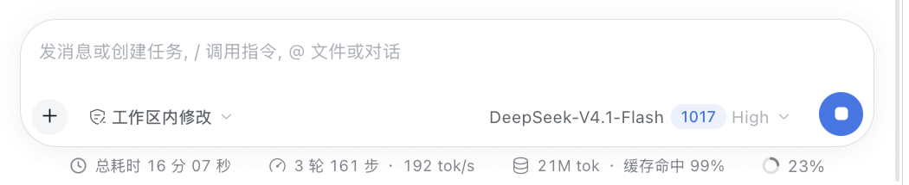

# 会话总耗时 · Session Total Time

在输入框下方左侧显示当前会话所有已完成轮次的总耗时。
Shows the total elapsed time of all completed turns in the current session, at the left of the composer footer.

截图展示的是中文界面；文案会跟随界面语言切换。
The screenshot shows the Chinese UI; the label follows the active UI locale.

## 简体中文

### 功能

- 在输入框下方状态行的最左侧显示当前会话的总耗时，排在轮次/速度、Token 用量等统计之前。
- 每轮回复的全部 token 输出完成、轮次结束后，自动把该轮的实际耗时累加进总数；正在输出的轮次暂不计入。
- 总耗时取自完整会话日志中的轮次起止时间，翻页、上下文压缩、刷新、恢复会话或派生会话后都不会丢失历史轮次。
- 自动选择易读单位：不足 10 秒保留一位小数（如 `3.4 秒`），不足 1 分钟显示整秒（如 `42 秒`），超过 1 分钟显示分钟和秒（如 `1 分 05 秒`），超过 1 小时显示小时和分钟（如 `1 小时 02 分`）。
- 鼠标悬停在总耗时上可查看已完成的轮次数。
- 文案跟随界面语言在中文和英文之间切换。

### 效果

截图中的输入框下方状态行最左侧显示 `总耗时 16 分 07 秒`，其后依次为轮次/速度、Token 用量与上下文占用统计。

## English

### Features

- Displays the session total at the far left of the composer footer, ahead of the shipped turn/speed and token-usage stats.
- Adds a turn's wall-clock duration once all of its tokens have been output and the turn ends; a running turn is not counted until it finishes.
- Reads turn boundaries from the full session log, so older turns stay included across paging, context compaction, reload, resume, and forked sessions.
- Formats the duration for readability: one decimal below 10 seconds (`3.4s`), whole seconds below a minute (`42s`), minutes and seconds from a minute (`1m 05s`), and hours and minutes past an hour (`1h 02m`).
- Hovering the total reveals the number of completed turns.
- Copy follows the active UI locale (Chinese/English).

### Effect

The screenshot shows the composer footer: `总耗时 16 分 07 秒` (total time) on the far left, followed by turn/speed, token usage, and context occupancy.
